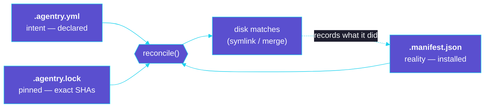
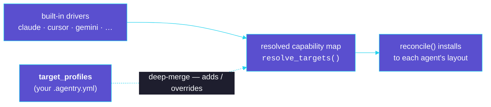

# agentry — Architecture

> The canonical design reference. If you're changing behavior, update this doc.

## 1. Problem: AI integration chaos

The AI ecosystem is expanding without standardization. A project that uses AI coding
tools accumulates **skills, agents, commands, tools, hooks, and MCP servers**, each of
which has to be dropped into a tool-specific location by hand:

- Claude Code reads `.claude/skills/`, `.claude/agents/`, `.claude/commands/`, `.claude/settings.json`, `.mcp.json`
- OpenCode reads `.opencode/…` and `opencode.json`
- Cursor reads `.cursor/rules/` and `.cursor/mcp.json`

…and the same again for every other agent. Nine agents ship as built-in drivers today
(Claude Code, OpenCode, Cursor, Codex, Gemini CLI, Windsurf, Kimi, GitHub Copilot, Kiro — see
[§5](#5-drivers-the-target-side-drivers-specpy-targetspy)), plus a tool-neutral `agents` target
for the shared `.agents/skills` layout, and you can add more from config alone.

Copy-pasting these by hand produces the classic failures software solved long ago:
no versioning, no single source of truth, duplicated effort across projects, drift
between machines, and no safe way to uninstall. This is **dependency hell** for AI.

## 2. Solution: dependency management for AI

`agentry` treats AI components as packages, modeled on `pip` / `yarn` / `uv`:

| File | Role | Committed? |
|---|---|---|
| `.agentry.yml` | **Intent** — declared sources + components (hand-editable) | ✅ yes |
| `.agentry.lock` | **Resolved truth** — exact commit SHAs / content hashes | ✅ yes |
| `.agentry/` | **Store** — downloaded git clones / local symlinks | ❌ gitignored |
| `.agentry/.manifest.json` | **Reality** — what is actually installed on disk | ❌ gitignored |

The three-way relationship is the heart of the design — `reconcile()` (run by `agentry sync`)
makes the disk match the declared, pinned intent:



## 3. Component model

```
ComponentType: skill | agent | command | tool | hook | mcp
Strategy:      link (file-based) | merge (config-based) | generate (self-installing)
```

| Type | Strategy | Why |
|---|---|---|
| skill, agent, command, tool | **link** | They are files/dirs a tool reads from a directory |
| hook, mcp | **merge** | They are entries inside a tool's JSON config, not standalone files |
| any (opt-in) | **generate** | The component has no symlinkable artifact and installs itself by running its own CLI |

**Generate strategy.** A component may carry a `generate` spec (`setup`/`command`/`produces`)
instead of an artifact — for tools like graphify that ship no skill file and generate one at
install time. Running third-party commands is **opt-in** (`agentry sync --allow-run`) and the
commands are printed before execution; `produces` lists the project-relative paths agentry
tracks so removal deletes exactly those and nothing else. See `installers/generate.py`.

## 4. Source-repo layout: convention or descriptor

A source (git repo or local dir) provides components in one of these ways, in precedence
order:
1. An explicit `agentry.yaml` **descriptor**. When there is one, it wins entirely and the
   other layouts are not consulted.
2. A **Claude Code plugin manifest**, `.claude-plugin/plugin.json`, at the subdir-adjusted
   source root.
3. An **`.apm/` package tree**, consumed directly (see below).
4. Otherwise, agentry's own **convention** scan.

**Convention** — mirror the standard agent layout:

```
skills/<name>/        directory (e.g. contains SKILL.md)        → link
agents/<name>.md      file                                      → link
commands/<name>.md    file                                      → link
tools/<name>/         directory                                 → link
hooks/<name>.json     JSON object of named entries              → merge
mcp/<name>.json       JSON object of named entries              → merge
```

**Descriptor** — an optional `agentry.yaml` (or `.yml`) at the source root lets a repo
**self-describe** an arbitrary layout. Each `provides` entry is either an explicit
`{ name, path }` or a `{ glob }` (name derived from each match — file stem, or dir name):

```yaml
# <source-repo>/agentry.yaml
version: 1
provides:
  skill:   [ { name: code-reviewer, path: packages/code-reviewer } ]
  agent:   [ { glob: "ai/agents/*.md" } ]
  mcp:     [ { glob: "servers/*.json" } ]
```

The component *type* still dictates shape (dir vs file + extension); the descriptor only
says *where*. Absent ⇒ convention scan (full back-compat).

**`.apm/`-format packages.** Such a package keeps its primitives under a `.apm/`
tree with that format's own names: `.apm/skills/<name>/`, `.apm/agents/<name>.agent.md`,
`.apm/prompts/<name>.prompt.md`, `.apm/instructions/<name>.instructions.md`. When a source
root contains `.apm/` (and no agentry descriptor), `discovery` reads it directly and maps
each primitive to its agentry type — skills → `skill`, agents → `agent`, **prompts →
`command`** — stripping the compound extension for the name and skipping `instructions`
(no agentry equivalent). The discovered artifact keeps its real `.apm/` path, so it installs
under agentry's own naming (e.g. `.apm/agents/x.agent.md` → a symlink at
`.claude/agents/x.md`). So such a package repo is consumable as an agentry source with no
republishing — the package-tree counterpart to `agentry import apm`, which translates the matching
`apm.yml` manifest.

**Claude Code plugin manifests (`.claude-plugin/plugin.json`).** `plugin_manifest.load`
translates the manifest into a `SourceDescriptor`-shaped layout, which discovery merges with the
convention scan, the same way as a descriptor. Discovery itself stays layout-agnostic. The keys
follow Claude's loader:
- **`commands` / `agents` replace** the default `commands/` and `agents/` scans. Each value is a
  path, a list of paths, or a `{name: {source}}` map. Inline `{content}` is skipped with a
  warning.
- **`skills` adds** to `skills/`. Each path is either a skill directory, meaning it contains
  `SKILL.md`, or a root of skill directories.
- **`hooks` / `mcpServers` add** to `hooks/hooks.json` and `.mcp.json`.
  - A path, or a list of paths, becomes one component per file, named after the file stem, so
    `-<harness>` variants still route (§5).
  - An inline object becomes one component, `plugin-hooks` / `plugin-mcp`. Its artifact is
    `plugin.json` itself, and only its `hooks` / `mcpServers` subtree is merged.
  - Hooks from `plugin.json` and from `hooks/hooks.json` both load. Where they share events they
    merge per element (§7).

The surrounding rules:
- **Confinement.** Every manifest path must be relative and use forward slashes, with no `..`.
  It must also resolve, symlinks included, inside the **source root**: the store's
  `.agentry/<source>`, not the plugin subdir. That lets a marketplace plugin symlink a sibling
  plugin's files, as Claude allows. Anything else is skipped with a warning before any
  filesystem lookup.
- **Fallbacks and warnings.** A malformed manifest, or one without a `name`, falls back to the
  convention scan with a warning. Keys agentry has no equivalent for (`outputStyles`,
  `lspServers`, …) and MCP bundles (`.mcpb` / `.dxt`) are reported, and summarised by sync when
  several sources have them.
- **Inline hooks that reference `${…_PLUGIN_ROOT}`** only resolve inside an installed plugin, so
  they are skipped per event. They are *not* routed to link+merge, which would link
  `.claude-plugin/` rather than the plugin root.
- `agentry why` shows where an inline component is defined: `.claude-plugin/plugin.json
  (hooks)`.

**Consumer-side overrides (third way).** When a source follows neither layout — a common
case for third-party skills whose repo *is* the skill — the consumer's `.agentry.yml`
component can resolve it directly, bypassing discovery:

- `path:` on a component points at an explicit artifact within the source (`path: "."` ⇒
  the source root is the skill). Handled in `reconcile.compute_desired`.
- `generate:` on a component installs via the generate strategy instead of an artifact.
- `transform:` on a component installs it as a **rewritten committed file** (copy-with-rewrite)
  instead of a live symlink — for agent/command (single-file) types only. `provider:
  strip-frontmatter` is deterministic (reproducible, runs every sync); `provider: agent` (with
  `prompt:`) synthesizes via your own agent CLI (`transform.command`), gated by
  `--allow-transform` and **write-once** (regenerate by removing the output), since its output
  isn't byte-reproducible. The never-clobber invariant holds — it refuses to overwrite an
  unmanaged file. See `installers/transform.py` and the transform-seam design spec.

**Catalogs (`registry.py`).** A `repositories:` list in `.agentry.yml` points at JSON
catalogs (a local file or an http(s) URL) that map a bare repo name to its source + optional
curated components. `agentry add <repo>` consults them in order and synthesizes the same Sources +
Components a user would hand-write, installing all of them, a `@name`-selected subset, or a
`--type`-filtered subset — so catalogs add resolution only, no new install mechanics. The
catalog is the JSON contract a hosted "artifactory" server would serve, so file and server are
interchangeable. URL catalogs are cached under `.agentry/repositories/`. `agentry init` seeds this
list with agentry's own curated catalog (`agentry` → `registry/repositories.json` on
`raw.githubusercontent.com`, see `DEFAULT_CATALOG_URL` in `config.py`) so name-based installs
work on a fresh project; `--no-default-catalog` starts empty.

A conventional-layout repo needs only a `source`; `expose` declares curated components (and
carries the `path`/`generate` for artifacts discovery can't infer). Two optional per-repo flags
shape the install layout at `agentry add` time:

- `"copy": true` — install this repo's file/dir components by **copying** instead of symlinking
  (real files, committable; default `false`).
- `"namespaced": true` (the **default**) — nest installs under a `<repo>/` subfolder for the
  component types the target agent's driver namespaces. The claude driver namespaces
  **commands** and **agents**, so a plugin's slash commands become namespaced
  (`.claude/commands/<repo>/adr.md` → `/<repo>:adr`); skills stay flat (Claude Code only
  discovers `.claude/skills/<name>/SKILL.md`). Set `"namespaced": false` for a flat layout.

```json
{
  "version": 1,
  "repositories": {
    "arckit": {
      "summary": "Architecture governance toolkit (skills, agents, commands, …)",
      "source": { "type": "git", "url": "https://github.com/tractorjuice/arc-kit", "ref": "main", "subdir": "plugins/arckit-claude" }
    },
    "graphify": {
      "summary": "Codebase → knowledge graph",
      "source": { "type": "git", "url": "https://github.com/safishamsi/graphify", "ref": "main" },
      "expose": [
        {
          "type": "skill",
          "name": "graphify",
          "generate": {
            "setup":   [["uv", "tool", "install", "graphifyy"]],
            "command": ["graphify", "install", "--project"],
            "produces": [".claude/skills/graphify"]
          }
        }
      ]
    }
  },
  "targets": {
    "myide": {
      "skill": { "strategy": "link", "dest": ".myide/skills/{name}" },
      "mcp":   { "strategy": "merge", "file": ".myide/mcp.json", "pointer": "mcpServers" }
    }
  }
}
```

**Driver overlays (`agentry target add` / `agentry target list`).** Beyond `repositories`, a catalog may
publish `targets` — shareable *driver overlays*, each a named definition of how some agent
installs every component type (the same shape as a `target_profiles[<target>]` block).
`agentry target add <name>` looks the overlay up across configured catalogs and merges it into the
project's `target_profiles` (never clobbering an existing rule), making an otherwise-undefined
target resolvable — community-supplied universality you don't have to author. `agentry target list`
shows the targets in use, whether each resolves (built-in / profile) or is unresolved, and which
overlays are installable; an unresolved target during `agentry sync` points here. This decentralizes
the cost of supporting a new agent: a driver is *data* anyone can publish, not a code change.
`agentry target drivers` lists every built-in driver name. Defining a target this way (built-in,
or via an overlay/hand-written `target_profiles`) only makes it *resolvable* — `agentry target use
<name>` (or `agentry init -t <name>` on an existing project) is the separate step that actually
activates it for the current project, by adding it to `targets:` and syncing.

**Authoring a catalog (`agentry catalog add-repo`).** Add an entry from a git/GitHub URL — a browser
`…/tree/<ref>/<subdir>` URL infers the `ref` and `subdir`; the name defaults to the repo
basename. `--discover` clones the repo and pre-fills `expose` from the components it finds. The
default catalog file is `registry/repositories.json` (override with `--file`).

**Dependencies (`requires`).** A descriptor entry may declare components it needs. Each
`requires` item points at another component by `type` + `name`, living in one of three
places — and is version-pinnable via `ref`:

```yaml
provides:
  skill:
    - name: code-reviewer
      path: skills/code-reviewer
      requires:
        - { type: skill, name: shared-style }                       # same source (this repo)
        - { type: tool, name: ripgrep, source: utils }              # another configured source
        - { type: skill, name: linter, url: "https://github.com/acme/linters.git", ref: v2 }
```

A `url` dependency is pulled in **transitively**: agentry synthesizes a source for it,
records it in `.agentry.lock` (marked `synthesized: true`), and installs it — but never
writes it into `.agentry.yml`. Intent stays minimal; the lock captures the full closure.
Only descriptor sources can declare dependencies (the convention scan carries none).

**Merge fragment contract.** A `hooks/*.json` or `mcp/*.json` file is a JSON **object of
named entries**. Each top-level key is merged under the target's pointer. Agentry records
each key together with a **fingerprint** of the value it wrote: `sha256` of the canonical JSON,
from `merge.fingerprint`. Ownership is proven by content, not by name (see §7). A key whose
value is a JSON **list** (an event-keyed hook array such as `PreToolUse: [ … ]`) is merged
**per element** instead: agentry appends its elements to the user's list and owns only those
(see §7, "Event-keyed hook arrays"). Two components shipping the same named key (or the
same install path) are settled in `.agentry.yml` order — see §7, "Duplicate claims". Example
`mcp/github.json`:

```json
{ "github": { "command": "npx", "args": ["-y", "@modelcontextprotocol/server-github"] } }
```

A fragment may also arrive **wrapped** under the section name it targets — the shape
real-world plugin files ship. A Claude Code `hooks.json` is
`{ "description": ..., "hooks": { "Stop": [...] } }` and an `.mcp.json` is
`{ "mcpServers": { ... } }`. `merge.select_entries` unwraps such a fragment using the
destination's `wrapper_keys` (the `pointer` plus any `aliases` — e.g. OpenCode's `mcp`
config also accepts the Claude-style `mcpServers` wrapper), so the real named entries
are merged and sibling metadata like `description` is dropped. An already-flat fragment
is used unchanged, so both shapes work.

**Per-harness fragment routing.** A repo may ship tool-specific hook/MCP fragments side by
side — e.g. `hooks/hooks.json` (canonical), `hooks/hooks-cursor.json`, `hooks/hooks-codex.json`.
agentry reads the `-<harness>` suffix and routes each variant **only** to its matching target, so
a Cursor or Codex fragment never lands in Claude's `settings.json`. The canonical, suffix-less
file applies to every target that supports the type **and has no enabled variant for it**; on a
target with an enabled `<base>-<target>` variant from the same source, the variant installs
*instead of* the canonical (resolved in `reconcile.compute_desired` via `_enabled_variants` /
`_routes_to`, since it depends on which components are enabled; `agentry why` shows which
fragment each target gets). As a final guard, a hook event Claude Code
doesn't recognize is dropped from `.claude/settings.json` with a warning rather than written out.

**Importing an apm-format project (`agentry import apm`, `apm_import.py`).** It's the same category
built on the same open standards, so an `apm.yml` is largely consumable. The importer is a
one-shot, offline translator: a `dependencies.apm` git shorthand `[host/]owner/repo/<typedir>/<name>`
becomes an agentry **git source** plus a **component** `(<type>, <name>)` — agentry resolves a
`(type, name)` to `<root>/<typedir>/<name>` by convention, so the package subpath maps with no
clone; local-path deps become **local sources**; inline `dependencies.mcp` servers become MCP
**fragments** in agentry's merge shape (above), written to a committed local source. apm `targets`
pass through (open strings). Anything not inferable offline — whole-repo deps, `plugins/*`
bundles, marketplace/bundle specs — is reported as a warning pointing at `agentry add` / `agentry list`,
never silently guessed. `translate_apm` is pure; the CLI layer writes files and the config.

## 5. Drivers: the target side (`drivers/`, `spec.py`, `targets.py`)

agentry's model has **two sides**. The **source side** (§4) is *canonical*: a repo author
writes a component once, in one place. The **target side** is a set of **drivers** — one
per AI agent — that each say *how* and *where* those components install into that agent.
This split is what lets one component repo serve many agents: author once, map per driver.

A **driver** ([`drivers/<agent>.py`](https://github.com/OpenTechIL/agentry)) is a small
dataclass that *composes* two things:

1. A **capability map** (`spec.TargetSpec`): per component type, a **link**/**copy**
   destination (path template) or a **merge** destination (config file + JSON pointer). A
   type absent from the map is unsupported for that agent → skipped with a warning. The spec
   also carries a **`memory_file`** — the tool's always-loaded instruction file
   (`.claude/CLAUDE.md`, `AGENTS.md`, …) that `agentry emit triggers` registers skill triggers
   into (`None` = the tool has no such concept). It survives a `target_profiles` override.
2. Optional **per-agent policies** for behavior that isn't pure path placement:
   - `HookEventPolicy` — validate hook-event keys (Claude Code rejects a `settings.json`
     carrying unknown event keys, so the claude driver drops them with a warning). No-op
     for agents without one.
   - `NamespacePolicy` — which component types nest under a `<repo>/` subfolder. The claude
     driver namespaces commands/agents (`.claude/commands/<repo>/adr.md` → `/<repo>:adr`).
   - `transform` — a **reserved seam** for future *semantic translation* (e.g. rewriting a
     fragment between JSON/TOML/YAML, or between agent formats). Default `None` everywhere
     today: agentry maps **placement**, it does not yet translate component formats.
3. Optional **format expectations** (`TargetSpec.expect`: component type →
   `spec.FormatExpectation`). They describe what an agent needs a component's *content* to
   look like, so agentry can **warn** when a correctly placed component won't actually work there.
   - **Fields:**
     - `extension`: the artifact's own suffix. It is checked for single-file artifacts only. It is
       skipped for directories, and for components with `transform:`, because the transformed
       output is what lands.
     - `events`: allowed hook-event keys.
     - `require`, `forbid`, `types`, `values`: per-entry field presence, absence, JSON type and
       allowed values.
     - `reject` and `reject_hint`: values the target accepts but misreads. Each one is reported
       with the hint.
     - `expects`: a human-readable description, used in the warning.
   - **The check.** `spec.check_format` is a pure function. It runs once per (component,
     target): on link, copy and transform artifacts after resolution, and on merge entries after
     `select_entries` and the hook filter. For link+merge it runs on the **rewritten** fragment,
     because that is what lands.
   - **What happens on a violation.** All of a pair's violations are collected into one warning,
     which names the workaround: ship a target-specific artifact, or override the type in
     `target_profiles`. The warning is also recorded in `DesiredPlan.format_issues`, and `doctor`
     reports it as a `format` warning, so `--strict` fails. Nothing on disk changes.
   - **Built-ins.**
     - opencode MCP requires `type` (`local`/`remote`) and an array `command`, and forbids
       Claude's `args`/`env`.
     - gemini commands must be `.toml`.
     - gemini MCP rejects `type: http`/`streamable-http`. Gemini reads `url` as SSE, so streamable
       HTTP servers need `httpUrl`.
     - gemini hooks must use `GEMINI_HOOK_EVENTS`. The same set also backs a *disabled*
       `HookEventPolicy`, so dropping unknown events later is a single flag flip.
   - **Profiles.** A `target_profiles` rule may carry `expect:` (`models.ExpectRule`, same keys).
     Unlike `dest`/`file`/`pointer`, which an override fully replaces, `expect` is **inherited**:
     - omitted: keep the built-in expectation;
     - `expect: {}`: drop it;
     - `expect: {…}`: replace it.

     The reason is that `expect` describes the tool's *content* schema, not placement. A
     placement-only override (for example `strategy: copy` on Windows) must not silently lose the
     check. This follows the same precedent as `memory_file`, which also survives an override.

`resolve_drivers(config)` is the effective map. It reuses `resolve_targets(config)` — the
single place that deep-merges the project's `target_profiles` over the built-in capability
maps — then re-attaches each built-in agent's policies. A tool defined **only** in
`target_profiles` (target ids are open strings, not a closed enum) gets a default
no-policy driver, so the data-driven escape hatch needs no code:

```yaml
# .agentry.yml
targets: [claude, mycli]              # active tools — may include custom names
target_profiles:
  mycli:                              # a new tool, no code required
    skill: { strategy: link,  dest: ".mycli/skills/{name}" }   # quote: {name} is literal
    mcp:   { strategy: merge, file: ".mycli/config.json", pointer: "mcpServers" }
  claude:
    tool:  { strategy: link,  dest: ".claude/plugins/tools/{name}" }   # override one path
```

> YAML note: a `dest` containing `{name}` must be **quoted**, or YAML reads `{…}` as a flow mapping.

A referenced target (project or component) with neither a built-in driver nor a profile is reported via `unresolved_targets`, which is fatal for sync (§6 step 0).

**Active vs. referenced targets.** The project's `targets:` is the **single switch**
(`Config.active_targets()`): agentry installs only into those. A component's own `targets:`
can only **narrow** that list, never switch a target on. `Component.applies_to` returns the
*intersection*. A component target that resolves but isn't active is skipped, with a warning
(`agentry target use <t>` to activate it). `doctor` reports it under `target`, sync summarises
the warnings, and `target list` shows it as "referenced but not active". A `generate`
component with no active target in common is skipped, and its generator does not run.
`Config.referenced_targets()`, the union of project and component lists, is used **only** for
the resolvability check (§6 step 0), so a typo in a component's list is still fatal. Dropping a
target from the project removes it everywhere: the next sync uninstalls those components
through the normal orphan path. Transitive dependencies inherit their root's narrowed set.

Adding an agent is **data, not a code change** — `target_profiles` deep-merges over the
built-ins to override paths or introduce an entirely new tool:



### Built-in drivers

| Type | Claude Code | OpenCode | Cursor | Gemini CLI | Windsurf | Kimi | Codex | Copilot | Kiro | Agents (universal) |
|---|---|---|---|---|---|---|---|---|---|---|
| skill | `.claude/skills/{name}` | `.opencode/skills/{name}` | — | `.gemini/skills/{name}` | `.windsurf/skills/{name}` | `.kimi-code/skills/{name}` | `.agents/skills/{name}` | `.github/skills/{name}` | `.kiro/skills/{name}` | `.agents/skills/{name}` |
| agent | `.claude/agents/{name}.md` | `.opencode/agents/{name}.md` | `.cursor/rules/{name}.mdc` | `.gemini/agents/{name}.md` | — | — | — | `.github/agents/{name}.agent.md` | — | — |
| command | `.claude/commands/{name}.md` | `.opencode/commands/{name}.md` | `.cursor/rules/{name}.mdc` | `.gemini/commands/{name}.toml` | `.windsurf/workflows/{name}.md` | — | — | `.github/prompts/{name}.prompt.md` | — | — |
| tool | `.claude/tools/{name}` | `.opencode/tools/{name}` | — | — | — | — | — | — | — | — |
| hook | merge `.claude/settings.json` → `hooks` | — | — | merge `.gemini/settings.json` → `hooks` | merge `.windsurf/hooks.json` → `hooks` | — | — | — | — | — |
| mcp | merge `.mcp.json` → `mcpServers` | merge `opencode.json` → `mcp` | merge `.cursor/mcp.json` → `mcpServers` | merge `.gemini/settings.json` → `mcpServers` | — | merge `.kimi-code/mcp.json` → `mcpServers` | merge `.codex/config.toml` → `mcp_servers` | merge `.vscode/mcp.json` → `servers` | merge `.kiro/settings/mcp.json` → `mcpServers` | — |
| memory (`emit triggers`) | `.claude/CLAUDE.md` | `AGENTS.md` | `.cursor/rules/agentry-triggers.mdc` | `GEMINI.md` | `.windsurf/rules/agentry-triggers.md` | `AGENTS.md` | `AGENTS.md` | `.github/copilot-instructions.md` | `.kiro/steering/agentry-triggers.md` | `AGENTS.md` |

A `—` means the agent either has no such concept or expects a format agentry can't yet
write. The **memory** row is the always-loaded instruction file `agentry emit triggers` writes a
marker-delimited skill-trigger block into (a markdown merge — like the JSON config merges, it
writes only the block it owns and leaves the rest of the file untouched). The newest drivers map what installs cleanly: skills everywhere, and MCP/hooks
merged wherever the destination is JSON **or TOML**. The merge installer chooses the codec
by the destination's extension — Codex's MCP servers merge into `.codex/config.toml` under
the snake_case `[mcp_servers]` table (written with `tomlkit`, preserving the rest of the
file), while the source fragment stays JSON. Still unmapped: per-tool **agent/command
definition formats** agentry doesn't translate (e.g. Gemini's TOML commands install via
`link` only when authored in that format; a Markdown one now draws a format warning, see
*format expectations* above), and **array-of-tables hooks** (Codex
`[[hooks.Event]]`, Kimi `[[hooks]]`) which don't fit the named-entry merge contract.

## 6. The reconcile flow (`agentry sync`)

```
0. Validate targets (fail fast)          targets.unresolved_targets(config)
   every referenced target (project `targets:` + declared components' `targets:`, i.e.
   `Config.referenced_targets()`) must be
   built-in or defined in target_profiles; otherwise raise UnresolvedTargetError (exit 1)
   naming each one with an offline did-you-mean (targets.suggest_target). Runs before any
   network, lock write, or orphan removal — a typo like `clade` changes nothing. A catalog
   overlay that is only *available* is still unresolved (hint: `agentry target add`).
   `status` raises the same error (no table); `doctor` reports it as an error.
   Config-editing commands (add/enable/disable/keep/…) validate the *edited* config in memory
   before saving: an edit that leaves an unresolved target is not saved, so "Nothing was
   changed" is literally true, while an edit that fixes the typo passes.

1. Resolve sources + dependency closure   deps.resolve_graph(config, lock, update=…)
   ├─ resolve every config source         resolver.resolve(source, pinned=deps._choose_pin(…))
   │    ├─ pin:   reuse the lock SHA only while the lock entry's type/url/ref still match the
   │    │         config (deps.pin_mismatch); a changed identity re-resolves (--frozen: abort)
   │    ├─ git:   clone once (re-clone if origin ≠ configured url) → fetch
   │    │         → checkout --detach <sha>                       → resolved = SHA
   │    └─ local: symlink store/<name> → abspath(path)          → resolved = sha256(tree)
   ├─ walk requires from the enabled roots (BFS), recursing into each dep's own descriptor
   │    ├─ url dep → synthesize a lock-only source, download, recurse
   │    ├─ cycles broken by a visited set on the component ref
   │    └─ version conflict (same repo/source, two refs) → abort with a clear error
   └─ emit an augmented (sources + components) graph; write .agentry.lock.

2. Compute desired state          reconcile.compute_desired(augmented_config) → DesiredPlan
   for each ENABLED component × each applicable target (project targets ∩ component targets;
   driver.strategy picks one):
     LINK       → DesiredLink(dest path, store artifact)   [path: override skips discovery]
     COPY       → DesiredCopy(dest path, store artifact)
     MERGE      → DesiredMerge(config file, pointer, fragment keys)
     LINK_MERGE → DesiredLinkMerge(link path, script dir, config file, pointer, rewritten keys)
     TRANSFORM  → DesiredTransform(dest path, source file, provider)   [component has transform:,
                  single-file type on a LINK target; replaces the link]
     GENERATE   → DesiredGenerate(component, generate spec)            [component has generate:]
   then settle duplicate claims in CLAIM ORDER (reconcile._resolve_claims; ADR-001 Rev 6):
     claim order = augmented components: declared in .agentry.yml order, then transitive in
     BFS order — a pure function of config + lock, identical on every machine.
     · paths (link / copy / transform / link+merge script link), compared case-insensitively:
       the earliest component keeps the path; later ones are dropped from the plan (W5-path;
       a link+merge loses as a pair)
     · named merge keys claimed by ≥2 components (unless every claim is a list — those share
       per element): the earliest wins (plan.winners); planning refuses the rest (W5)

3. Diff against the manifest and apply (in this order)
   transfers:   report each unit moving to its claim-order winner once, in `updated`
   prune:       remove orphaned links, then copies, then transforms — ALL before any path is
                installed, so a path moving between strategies never trips "not managed"
   links:       create/refresh desired (a same-strategy transfer relinks + relabels the record)
   copies:      copy desired (never over an unmanaged path)
   generated:   remove orphans (delete produced paths) → run (gated by trust / --allow-run),
                record produced paths
   merge pass:  one file-grouped pass over merges, then link+merges (reconcile.
                _reconcile_merge_targets). It runs after generators, so conflicts are judged
                against what a generator wrote:
                  · parse each destination once (merge.Documents); migrate v1 records in memory
                  · remove orphaned records (only keys whose fingerprint still matches)
                  · release pass: a later claimant's owned entry for a key it lost is removed
                    (fingerprint-checked) so the winner installs it in the same sync
                  · plan each component atomically against the document: refuse (warn) on a
                    pre-existing user key, a non-object section, or a key another record owns
                  · link+merge links the script dir only if its merge half was accepted
                  · write each changed file once; an unchanged file is not rewritten
   transforms:  render via provider (agent provider gated by --allow-transform), write as a
                manifest-tracked file (their orphans were pruned above)

4. Persist manifest (and the lock again if trust was granted); ensure .agentry/ is in .gitignore.
```

`sync` is **idempotent**: a second run with the same inputs is a no-op. **`agentry update`** is
the only operation that advances versions. It ignores the locked SHA, re-resolves each ref to its
tip, and rewrites the lock. With no argument it does this for every source.
`agentry update A [B…]` (`resolve_graph(update_only=…)`) scopes it to the named sources, which may be configured or synthesized
lock entries:
- **Validation.** Unknown names fail before any network call or write, with exit 1 and a
  did-you-mean.
- **Other sources.** Every other source keeps its pin, its trust and its lock bytes.
- **Generators.** Only generators of the updated sources re-run.
- **Transitive dependencies** of a named source are not re-pinned automatically. If the source's
  new revision requires a dependency at a *different* ref, the pin-identity rule (step 1) re-pins
  that dependency anyway; if it requires the same ref, its pin is kept. Two exceptions:
  - A dependency the new revision **newly introduces** has no pin, so it resolves normally.
  - If the new revision needs a component that the **pinned** dependency doesn't provide, a scoped
    update **exits 1 before the lock is written**, suggesting `agentry update A <dep>`
    (`deps._check_provided`, which runs inside `resolve_graph`). Plain `sync` keeps its existing
    "not provided" warning in the same situation.
- **A failed resolve changes nothing.** Link installs are live symlinks into the store, so if
  `resolve_graph` fails part-way, every git source this run already moved is checked back out
  at its locked SHA before the error propagates (`deps._restore_checkouts`). That covers a
  refused scoped update and any failure in the middle of an unscoped `update`. The checkout is
  local, with no network, and the lock is never written.

## 7. Safety model

agentry never destroys anything it didn't create. Two invariants enforce this:

- **Links** — `link.remove_link` / overwrite only act on a path that is a symlink whose
  *lexical* target resolves into `.agentry/`. A user-authored file or an unrelated
  symlink at the same path is left alone (and overwrite raises rather than clobbers).
  The check is lexical (`abspath`, not `resolve`) so a local source — itself a symlink
  in the store — is still recognized as managed.
- **Merges** — ownership is proven by content (ADR-001; manifest v2 records an `OwnedEntry`
  per key):
  - **One pass.** All merge and link+merge destinations are reconciled in a single pass that
    runs after generators (`reconcile._reconcile_merge_targets`). Each file is parsed once and
    written once, and only if it changed.
  - **Install refuses** a key agentry did not create. A differing value is left byte-identical
    and the component is not merged into that destination, with a warning. An identical value
    is recorded as `preexisting`: it satisfies the component, but is never removed. Install
    also refuses a pointer section that is not an object, and a key an **earlier-listed**
    component claims (W5, see "Duplicate claims" below). Refusal is all-or-nothing only on **first install** in a destination (W3, the
    non-object section, is always whole-destination). Once a component is installed there, a
    conflicting key is refused **per key**: the warning names it, the status row shows `drift`,
    and the component's other keys keep updating (ADR-001 rev 4). For link+merge, the
    script directory is not linked either.
  - **User edits win.** If the on-disk value no longer matches the recorded fingerprint, sync
    keeps the user's version. It warns, and `status` and `doctor` report `drift` with a note.
    Sync does not revert the edit.
  - **Duplicate claims** (ADR-001 Rev 6). When two components claim the same named merge key
    or the same install path, the one **earlier in claim order** wins. Claim order is declared
    components in `.agentry.yml` order, then transitive ones. Every machine with the same config
    and lock agrees, unlike "first installed keeps it". The loser gets W5; its status row is
    `missing` with a note; `doctor --strict` fails. Paths compare case-insensitively (macOS and
    Windows filesystems are). If a reorder or a new component moves a unit, it transfers in one
    sync: the loser's entry is removed fingerprint-checked (a user edit is never overwritten:
    W4 for the loser, W1 for the winner) and `sync` prints once `… now comes from {winner}
    instead of {loser} — to keep {loser}'s version, list it before {winner} …`. A transitive
    claimant's hint says to **declare** it in `.agentry.yml` instead. Identical hook groups
    under array mode are shared, never W5; a list vs. an object on one key is W5.
  - **Keeping your own value** (`keep:`). A component's `keep:` list in `.agentry.yml` names
    merged keys the user takes over. A bare `key` applies to every target; `<target>:<key>` limits
    it to one. `agentry keep <ref> [<target>:]<key>` appends to the list.
    - **Effect.** Agentry records a kept key as `preexisting` and never writes or removes it
      again. That holds on disable and removal too, because keep is read from the declared
      config, including disabled components. No drift warning is emitted, and `status` shows
      `ok (kept)`.
    - **Kept but missing.** A kept key is never created. Where a target has no entry for it (a
      target added after a bare keep, or the user deleted their entry), `status` reports
      `missing` with a note, and sync and `doctor` warn. Nothing is written.
    - **Typos.** A `keep` entry that matches no key the component merges gets one warning.
    - **Hints.** Drift and refusal messages suggest `agentry keep`. They give the bare key only
      when it drifted on every target the component writes it to; otherwise they give
      `<target>:<key>`, so following the hint never freezes a healthy target.
    - **No reclaim.** Removing a key from `keep:` takes nothing back. The entry stays the user's
      until they delete it; the next sync then re-creates agentry's version and owns it.
    - **Why config, not the manifest.** The decision lives in committed config so it is shared
      and reviewable. The manifest is gitignored and per-machine.
  - **Removal** deletes only owned, non-preexisting keys whose fingerprint still matches. An
    edited entry is left in place, with a warning. A key whose ownership was never proven (no
    fingerprint) is never removed.
  - **Old manifests.** A v1 manifest (keys only) loads unchanged and is migrated on the next
    sync. A recorded key becomes owned only if its on-disk value equals what the component
    ships now. For link+merge, the comparison uses the rewritten fragment. Otherwise the key is
    *unproven*: it is never updated or removed, and sync warns. `status` and `doctor` report it as
    `drift`, with a note on how to take the current version. Run a plain
    `agentry sync` once after upgrading, before `agentry update`, so the comparison is made
    against the locked revision. `status` migrates in memory and never writes.
  - **Event-keyed hook arrays** (array mode; ADR-001 PR 2). This applies when the desired value
    is a list, as in the Claude, Gemini and Windsurf hooks.
    - **Ownership per element.** Ownership is per **element**, identified by its fingerprint.
      The record's `items` is ordered and aligned with the fragment's list. A `None` slot means
      the slot is satisfied by the user's identical element, which agentry doesn't own.
    - **Installing.** Agentry appends its elements to the user's list. The user's elements and
      their order are never touched.
    - **Updating.** An update replaces agentry's own element **in place**, pairing positions
      between the old record and the new fragment.
    - **Shared elements.** Elements are reference-counted across components: an identical
      element two components ship is shared, and kept or pre-existing records count as claims.
      Removing a component deletes only elements no other live record claims. It deletes the
      event key only if the key is empty and agentry created it.
    - **Edited elements.** An element of ours that the user edited or removed is reported (W2)
      and not re-appended.
    - **The user's identical copy.** A `None` slot also records the user's element fingerprint
      (`user_items`). If upstream later changes that element while the user's copy is still
      there, agentry keeps the user's and does **not** append. Appending would run the hook
      twice. It reports a per-element W1b with a `keep` hint that covers the whole event. Once
      the user deletes their copy, the next sync installs ours.
    - **`created_key` hand-over.** `created_key` passes from a leaving record to one that stays
      on the same key (`_hand_over_created_keys`, a pre-pass before planning). This means the
      last component deletes an event key it empties.
    - **`keep:`** on an event key stops that component writing to it. Its elements still count
      as claims.
    - **Conflicts.** A list on one side and an object on the other is a conflict (W1/W5).
    - **Older records.** PR 1 and v1 records for list keys convert in place. A proven record
      converts exactly. An unproven one claims only elements identical to what the component
      ships now, and never deletes the key. This includes records being disabled in the same
      sync, whose fragment is re-read from the source. A record whose fragment can't be
      re-derived stays named.

### `${VAR}` placeholders: ship verbatim, warn on dead refs

MCP/hook fragments routinely carry `${VAR}` references (tokens, hosts). agentry **does
not resolve them at merge** — it ships the placeholder verbatim and lets the runtime
agent expand it at session start. This is deliberate: resolving early would bake one
machine's environment into a config meant to travel, and would leak secrets into a
file that may be committed.

The one case that contract can't self-protect against is a reference that is **unset
*and* has no default** (`${VAR}`, not `${VAR:-x}`): it ships as a dead placeholder.
Both `agentry sync` and `agentry doctor` scan for exactly that and emit a warning (shared
`envscan.unset_env_refs`). The scan covers only the text agentry actually installs
(`plugin_manifest.merge_text`). For a `plugin.json` artifact that is just its `hooks` /
`mcpServers` subtree, so placeholders in fields that aren't installed are never reported.
`${CLAUDE_PLUGIN_DATA}` gets its own warning, because it exists only inside an installed Claude
plugin. `agentry doctor --strict` turns the warning into a non-zero exit,
which is the CI guardrail. The merge still proceeds — the warning is loud, not blocking —
so a value the user *will* set at runtime isn't spuriously rejected.

### Per-source consent for install-time code execution

A component with a `generate` spec runs a command during `agentry sync`. Beyond the one-shot
`--allow-run` blanket, agentry records **per-source trust** in the lock (`LockEntry.trusted`),
pinned to the source's resolved SHA. A trusted source's generators run without `--allow-run`;
an untrusted one is skipped with a warning unless consent is granted — via `agentry trust <source>`
or the interactive prompt in `agentry sync` (a `TrustCallback` the CLI supplies; non-TTY callers
decline silently, so CI stays deterministic). Because trust is pinned to the SHA, a source that
moves to a new revision drops its consent and must be re-confirmed (`deps.ensure_resolved`
carries trust forward only while the hash, the source type, **and the url** are all unchanged).
A changed url revokes trust even at the same SHA (a fork shares history, not its owner); a ref
change that lands on the same SHA keeps it, since trust is about content. Trust gates **generators only** — the
single thing agentry itself executes; hooks are run by the harness, not agentry.

### Deterministic, OS-independent local-source hashing

A local source's lock value is a content hash of its tree (`resolver._hash_dir`). By default
text files are hashed in a canonical **LF** form (`hashing.normalize_line_endings: true`), so
the same content produces the same `sha256:` on Windows and Unix — a checkout's `autocrlf`
can't trigger phantom `--frozen` drift. Binary files (anything not valid UTF-8) are always
hashed raw. Set `hashing.normalize_line_endings: false` in `.agentry.yml` to restore exact
byte-for-byte hashing when line-ending fidelity matters.

## 8. Module map

This is the **single** module map for the project. `AGENTS.md` and `CONTRIBUTING.md` link
here rather than keeping their own copies, which had drifted out of date independently.

```
progname.py     the invoked command name (agentry / agy / agyx) for user-facing hints
cli.py          Typer app — command wiring + Rich output
models.py       pydantic: Config, Source, Component, Lock, Manifest, enums; path/URL validation
config.py       .agentry.yml round-trip (ruamel, comment-preserving) + mutators
lockfile.py     .agentry.lock read/write
spec.py         capability-map dataclasses (TargetSpec / MergeDest / LinkMergeDest)
drivers/        one module per AI agent (claude, opencode, cursor, codex, gemini, windsurf, kimi, copilot, kiro)
                 plus `agents` — the tool-neutral .agents/skills universal target
  base.py       Driver = capability map + optional policies (hook-event, namespace, transform)
  __init__.py   BUILTIN_DRIVERS registry + resolve_drivers()
targets.py      effective capability map: BUILTIN_TARGETS (from drivers) + target_profiles merge
discovery.py    scan a source for available components + their `requires` (LAYOUT)
resolver.py     download/checkout into the store; resolve refs → SHA/hash
deps.py         transitive dependency closure (recursive, version-aware) → augmented graph
registry.py     resolve a bare repo name via external catalogs (file/URL) → Sources + Components
apm_import.py   translate an apm-format manifest (apm.yml) → agentry sources/components/MCP
manifest.py     .agentry/.manifest.json read/write
naming.py       derive a short, stable name from a git URL or local path (repo basename)
emit.py         compose AGENTS.md; splice the skill-trigger block into each memory file
envscan.py      scan merge fragments for dead ${VAR} placeholders
doctor.py       aggregate preflight checks (targets, components, env vars, drift, command name)
installers/
  _paths.py     shared helpers: parent pruning + the confined() / require_confined() guard
  link.py       symlink create/remove/state (lexical, store-scoped)
  copy.py       copy a file/dir as a committable real artifact (manifest-tracked ownership)
  merge.py      JSON/TOML inject/remove/state (key-scoped, reversible; codec by file ext)
  link_merge.py symlink + config merge together, rewriting plugin-root command paths
  generate.py   run a component's own installer (gated); track produced files for safe removal
  transform.py  copy-with-rewrite: materialize a component through a content provider
reconcile.py    sync engine + status (drift report)
gitignore.py    ensure .agentry/ is ignored
```

## 9. Extension points

- **New agent (driver)** — *no code needed* for a one-off: define the tool under
  `target_profiles` in `.agentry.yml`. To ship it as a **built-in driver**, add a
  `drivers/<agent>.py` exposing a `DRIVER` (its `TargetSpec` + any policies), register it in
  `BUILTIN_DRIVERS`, add the name to `models.BUILTIN_TARGET_NAMES`, and add a `test_drivers.py`
  case. See **Adding a driver** in `CONTRIBUTING.md`.
- **New component type** — add to `ComponentType`, `LINK_TYPES`/`MERGE_TYPES`, `TYPE_IS_DIR`/
  `TYPE_EXT`, and a destination in each relevant driver's `TargetSpec`.
- **New source layout** — *no code needed*: ship an `agentry.yaml` descriptor in the source repo.
- **New source kind** — add a `SourceType` and a branch in `resolver.resolve`.

## 10. Deferred (future phases)

- **Hosted catalog server** — the catalog format and name-based `agentry add`/`agentry search`
  ship today against file/URL catalogs (`registry.py`); a hosted catalog server + upload flow
  (serving the same JSON contract that `agentry catalog add-repo` authors locally) is the remaining
  piece.
- **TOML array-of-tables hooks** — Codex (`[[hooks.Event]]`) and Kimi (`[[hooks]]`) keep hooks
  as an array of tables rather than named keys under a pointer, so they don't fit the current
  key-scoped reversible merge contract. (TOML *named-table* merge — Codex MCP `[mcp_servers]` —
  already ships; see §5.)
- **Semantic translation** — the `transform` seam on a driver (§5) would let a component
  authored for one agent be reshaped for another (format/field translation), turning today's
  placement-mapping into true write-once-run-anywhere. *First step shipped:* `agentry emit
  agents-md` (`emit.py`) composes a portable `AGENTS.md` from a project's skills/agents/commands
  — deterministic and CI-verifiable (`--check`), produced at author time and committed. It's the
  no-LLM half of the transform design (kept in the maintainers' local, unpublished design notes);
  the `--agent` provider that *synthesizes* (vs concatenates) by shelling out to the user's own
  agent CLI (`transform.command` in `.agentry.yml`; prompt on stdin) is now shipped — gated by
  `--allow-transform`, with a diff preview + confirmation (`--yes` to auto-apply in CI), and
  `--check` reserved for the reproducible deterministic mode. agentry embeds no model or key, in
  keeping with "nothing of it runs while your agents do." Per-component copy-with-rewrite has
  since shipped too (`transform:` on a component, §4; `installers/transform.py`); what remains is
  the driver-level `transform` seam for cross-agent format/field translation.
- **Compatibility metadata** — components declare supported model/tool versions; sync warns on mismatch.
- **Automatic copy fallback** — the **copy** strategy itself ships (a target's `copy` capability
  map, or `"copy": true` per catalog repo, installs real files tracked in the manifest), but it is
  opt-in. What remains is choosing it *automatically* when the filesystem refuses symlinks
  (Windows without Developer Mode); today `symlink_to` fails there instead of falling back.
- **TUI** — a Textual front-end over this same core (browse/toggle/sync).
